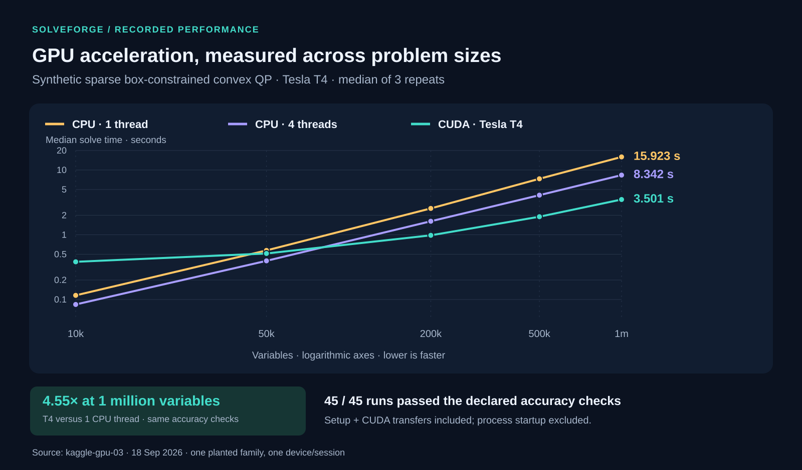
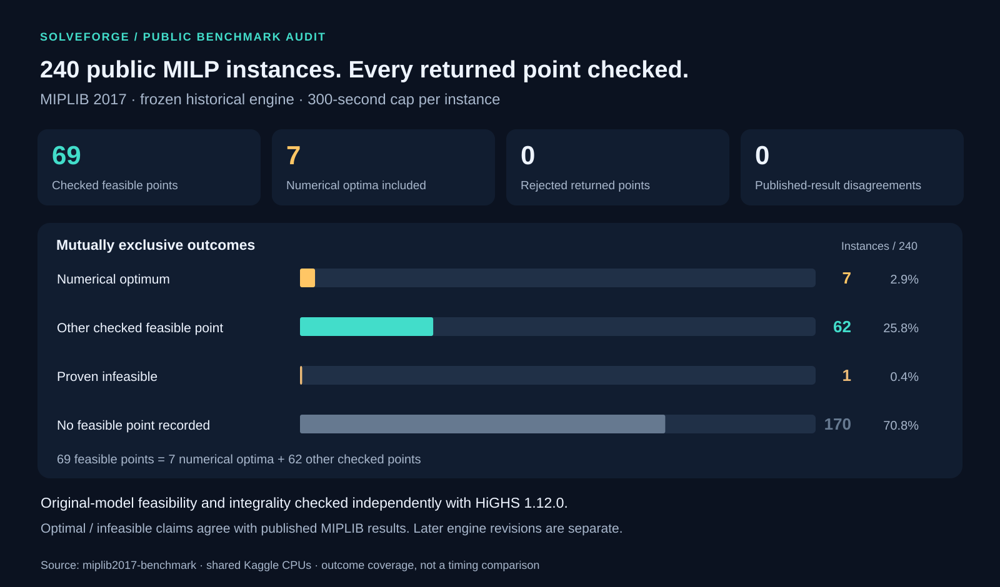

# README benchmark charts

These figures are generated from retained experiment records. Run from the repository root using Python 3; only its standard library is required:

```sh
python3 06-media/benchmarks/build_benchmark_charts.py
```

The script reads the original JSON without changing it, validates the counts and medians, and writes two SVG files alongside this guide.

## CPU and GPU box-QP timing



**Caption:** Median solve time for one planted sparse tridiagonal box-constrained convex-QP family, on a Tesla T4 and Intel Xeon host with one or four CPU threads. Three repeats per size/backend; all 45 runs passed the same accuracy checks. The GPU median is 3.501 seconds at one million variables, 4.55× faster than one CPU thread. Both axes are logarithmic.

**Inputs:**

- [Raw 45 run records](../../02-software/solver/reports/kaggle-gpu-03/returned/results.json)
- [Retained median summary and device metadata](../../02-software/solver/reports/kaggle-gpu-03/returned/SUMMARY.json)
- [Report and accuracy contract](../../02-software/solver/reports/kaggle-gpu-03/REPORT.md)
- [Historical measurement harness](../../02-software/solver/reports/kaggle-gpu-03/kernel/gpu_validation.py)
- [Timing boundary in the scale benchmark](../../02-software/solver/src/scale_benchmark.cpp)

**Aggregation:** Group raw records by `columns`, `backend`, and `threads`; require three passing runs in each group; take `statistics.median` of `solve_seconds`. Assert exact agreement within floating-point tolerance with `median_solve_seconds` in the summary. Values are rounded only for chart labels. The chart preserves the report's medians, not the separate Python `wall_seconds` subprocess measurement. The C++ interval covers `solve_accelerated_box`, including its setup and CUDA transfers, while model generation and whole-process startup sit outside that interval. The report's broad end-to-end wording should be read with that precise boundary.

| Variables | CPU 1 thread (s) | CPU 4 threads (s) | T4 (s) |
|---:|---:|---:|---:|
| 10,000 | 0.115910375 | 0.083822134 | 0.382125750 |
| 50,000 | 0.572917063 | 0.395517485 | 0.513866790 |
| 200,000 | 2.550901775 | 1.615818305 | 0.979924912 |
| 500,000 | 7.314432440 | 4.085954575 | 1.899622931 |
| 1,000,000 | 15.922824207 | 8.341628819 | 3.501480354 |

This is one family, one device and one session, recorded on 18 September 2026. It does not measure GPU MILP, general constrained-QP speed, or competitors' performance.

## Historical MIPLIB 2017 outcomes



**Caption:** All 240 MIPLIB 2017 benchmark instances evaluated with a frozen historical engine and a 300-second per-instance cap. The 69 independently checked feasible points include seven numerical optima. Mutually exclusive categories are seven numerical optima, 62 other checked feasible points, one proven infeasible instance, and 170 instances with no point recorded. No returned points were rejected and no optimal/infeasible claims disagreed with the retained published results.

**Inputs:**

- [Historical consolidated summary](../../02-software/solver/reports/miplib2017-benchmark/SUMMARY.json)
- [Complete per-instance table](../../02-software/solver/reports/miplib2017-benchmark/TABLE.md)
- [Benchmark report and method](../../02-software/solver/reports/miplib2017-benchmark/REPORT.md)

**Aggregation:** Read `proven_optimal`, `proven_infeasible`, `validated_points_including_optima`, and `no_point` from the consolidated summary. Compute the other-feasible category as `validated_points_including_optima - proven_optimal` (69 − 7 = 62), preventing double counting. Assert the four categories sum to `instances` (240). Rejection and disagreement counters are lengths of their retained lists. Percentages divide each mutually exclusive count by 240; no incomplete case is treated as infeasible.

These outcomes belong to the frozen historical engine with SHA-256 beginning `e40e849f69d2`, not to later separately measured revisions. Two instances shared four cloud vCPUs per session, so the chart reports outcomes at a fixed budget rather than a cross-solver timing ranking.
