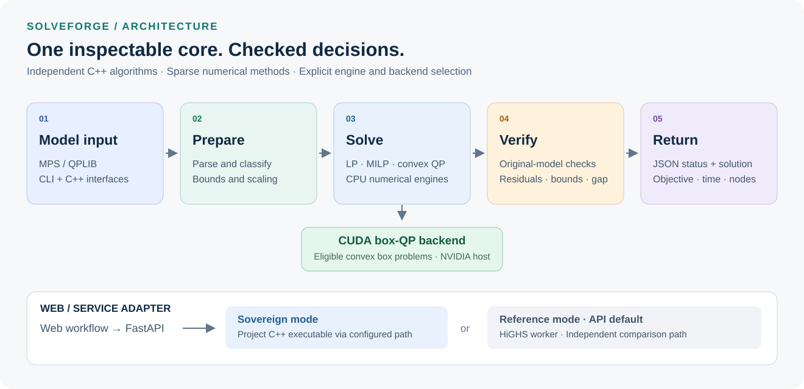
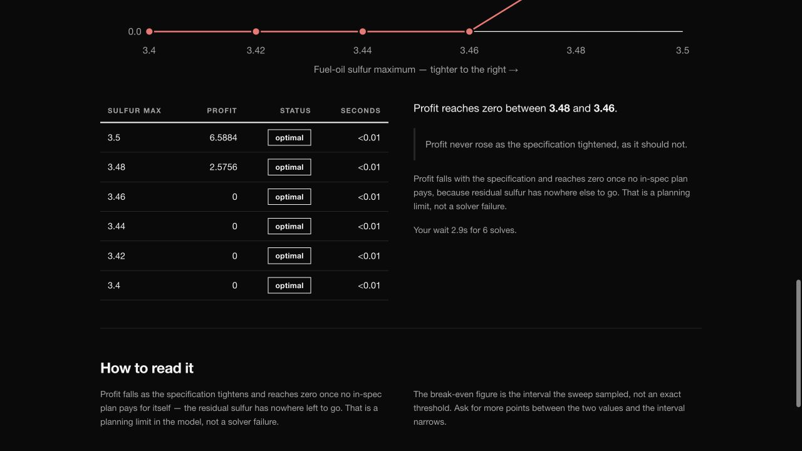
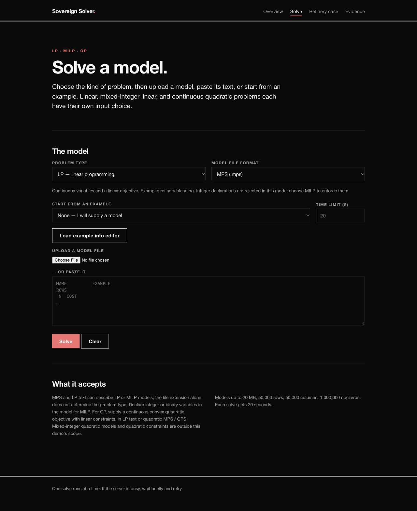
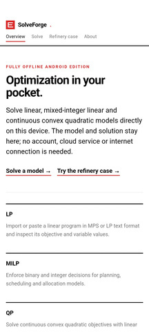
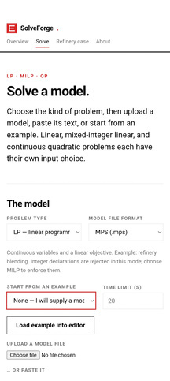
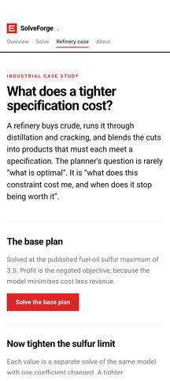
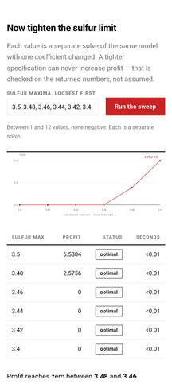

<h1 align="center">SolveForge · HyperGrey</h1>
<p align="center"><strong>Inspectable optimization. Decisions you can check.</strong></p>
<p align="center">An independently implemented LP, MILP and convex-QP solver core for industrial planning.</p>

<p align="center">
  
  
  
  
</p>
<p align="center">
  
  
  
  
</p>

<p align="center">
  <a href="https://sovereign-solver-gilt.vercel.app/solve">Live workbench</a> ·
  <a href="https://www.youtube.com/playlist?list=PLRNv4l1yWhLs">Demo playlist</a> ·
  <a href="https://drive.google.com/drive/folders/1qeA-JjZ5pdWwm-EGbLhcT_W3obh-BZ51">Android downloads</a> ·
  <a href="07-documentation/technical-report/solver_research.pdf">Research paper</a> ·
  <a href="https://www.kaggle.com/code/prakhar1803/solveforge-cpu-gpu-routing-reference">CPU/GPU routing notebook</a>
</p>

SolveForge is **HyperGrey's Smart India Hackathon 2026** response to **SIH26119: Indigenous GPU-Accelerated Optimization Solver**, from **Mangalore Refinery and Petrochemicals Limited (MRPL)** under Smart Automation. It brings together mathematical optimization, sparse numerical methods, original-model verification, selective GPU acceleration, industrial examples, and an accessible demonstration workflow.

The central question is practical: **how can an industrial planner obtain a useful decision, understand its quality, and retain control of the engine that produced it?** The project answers with an inspectable C++ core, structured results, independent checks, and reproducible evidence.

| Independent core | Large-scale GPU study | Public MILP campaign | Research foundation |
|:---:|:---:|:---:|:---:|
| **LP · MILP · convex QP** | **1,000,000 variables** | **240 instances audited** | **60 sources / 15 topics** |
| C++ algorithms and JSON CLI | Checked, planted box-QP family | Full historical MIPLIB 2017 set | 43 local reference PDFs |

## Explore the project

| Review route | Start here |
|---|---|
| **Try a model** | [Live solver workbench](https://sovereign-solver-gilt.vercel.app/solve), [refinery case](https://sovereign-solver-gilt.vercel.app/refinery), and [Android packages](https://drive.google.com/drive/folders/1qeA-JjZ5pdWwm-EGbLhcT_W3obh-BZ51) |
| **Inspect the engine** | [Solver source](04-software/solver/), [architecture](04-software/solver/docs/V2_ARCHITECTURE.md), and [CLI/C++ API](04-software/solver/docs/CLI_API.md) |
| **Review the evidence** | [GPU experiment](04-software/solver/reports/kaggle-gpu-03/REPORT.md), [MIPLIB campaign](04-software/solver/reports/miplib2017-benchmark/REPORT.md), and [public LP checks](04-software/solver/reports/lp-pivot-iteration-01/REPORT.md) |
| **Follow the reasoning** | [Technical paper](07-documentation/technical-report/solver_research.pdf), [research map](03-research/RESEARCH_MAP.md), and [routing notebook](https://www.kaggle.com/code/prakhar1803/solveforge-cpu-gpu-routing-reference) |
| **Watch the demonstrations** | [Software demo playlist](https://www.youtube.com/playlist?list=PLRNv4l1yWhLs) and [supplied project collection](https://drive.google.com/drive/folders/1nRVg4Sxxy0ztX5gHeZVvTwpCjPGWnLbT) |

**Contents:** [Architecture](#architecture) · [Numerical core](#numerical-core) · [Benchmark results](#benchmark-results) · [Industrial examples](#industrial-examples) · [Web and Android](#web-and-android) · [Research](#research-and-cpugpu-routing) · [Build and run](#build-and-run) · [Repository map](#repository-map)

## Architecture

The core follows a clear path: **read the model → prepare and scale → solve → check against the original model → return the decision and its diagnostics**.

[](08-media/readme/solveforge-architecture.svg)

*Core and service architecture. The FastAPI adapter exposes explicit Sovereign and HiGHS reference modes; the standalone C++ engine owns its numerical algorithms. Click the diagram to inspect it.*

| Layer | Delivered implementation |
|---|---|
| **Model input** | MPS LP/MILP, continuous convex QPLIB models, C++ interfaces, and a JSON command-line interface |
| **Preparation** | Model validation, presolve, bound propagation, scaling, and sparse representations |
| **Optimization** | Own LP, MILP and convex-QP engines; optional OpenMP and a CUDA backend for eligible box QPs |
| **Verification** | Original-model feasibility, objective reconstruction, integrality, residuals, bounds, and certificate checks |
| **Service** | FastAPI model-solving and refinery endpoints, resource limits, isolated reference workers, Docker/Caddy deployment configuration |
| **Demonstrations** | Public web workbench, online/offline Android packages, refinery sensitivity views, and recorded walkthroughs |

The core is independently implemented in [C++ source](04-software/solver/src/) and [public headers](04-software/solver/include/). HiGHS and OSQP supply separate reference comparisons. The API selects `SOLVER_ENGINE=sovereign` for the project executable or its default `reference` mode for HiGHS; responses identify the engine used.

## Numerical core

Refinery blending, dispatch, production and logistics have different mathematical structures. SolveForge provides a modular engine for three initial problem families:

| Family | Mathematical role | Implemented methods |
|---|---|---|
| **LP** | Linear objectives with row and variable bounds | Sparse revised simplex, bounded dual simplex, reusable bases and warm starts |
| **MILP** | Linear models with integer or binary decisions | Branch-and-bound/cut, best-bound search, propagation, cover cuts, diving, feasibility pump and repair heuristics |
| **Convex QP** | Quadratic objectives with linear constraints or box bounds | Scaled ADMM, preconditioned conjugate gradient, KKT polishing, structured dual-Newton and accelerated projected-gradient paths |

### Numerical engineering

- **Sparse basis machinery:** left-looking LU, threshold pivoting, eta updates and controlled refactorization.
- **Stable LP operations:** power-of-two scaling, Harris ratio tests, Devex/steepest-edge pricing, bound flips and primal cleanup.
- **Search efficiency:** warm relaxation bases, incumbent improvement, shared bound trails and guarded open-node storage.
- **Checks at the original model:** reconstructed objectives, feasibility and integrality tolerances, primal/dual gaps, LP Farkas multipliers and unbounded rays.
- **Inspectability:** status, objective, bound, gap, timing, nodes, and solution values are exposed through the CLI and retained run records.

The [bounded-simplex guide](04-software/solver/docs/BOUNDED_SIMPLEX.md), [MILP frontier notes](04-software/solver/docs/MILP_FRONTIER.md), and [architecture reference](04-software/solver/docs/V2_ARCHITECTURE.md) connect these choices to their implementations and tests. General numerical statuses use documented tolerances; the [small-binary proof mode](04-software/solver/docs/MILP_BINARY_PROOF.md) has a separately guarded exact-arithmetic contract.

## Benchmark results

### CPU and GPU at the same accuracy

The repeated **Tesla T4 box-QP experiment** covers five model sizes, three compute configurations, and three repeats: **45/45 runs returned checked optimal results** against a planted solution.

[](08-media/readme/box-qp-cpu-gpu-t4-medians.svg)

| Box-QP variables | CPU, 1 thread | CPU, 4 threads | Tesla T4 |
|---:|---:|---:|---:|
| 10,000 | 0.116 s | 0.084 s | 0.382 s |
| 50,000 | 0.573 s | 0.396 s | 0.514 s |
| 200,000 | 2.551 s | 1.616 s | 0.980 s |
| 500,000 | 7.314 s | 4.086 s | 1.900 s |
| **1,000,000** | **15.923 s** | **8.342 s** | **3.501 s** |

At one million variables, the median GPU solve is **4.55× faster than one CPU thread** and **2.38× faster than four CPU threads**. The crossover motivates selective acceleration: CPU is the useful choice for the smallest case, while larger eligible problems amortize GPU setup and transfers.

*Recorded solver timings for a planted sparse, tridiagonal, box-constrained convex-QP family. GPU timing includes its transfer/setup work; process startup and model generation are separate. These are medians of three repeats per configuration.* [Report and raw records](04-software/solver/reports/kaggle-gpu-03/REPORT.md) · [Chart sources](08-media/readme/benchmark-charts.md).

### Public LP and mixed-integer models

| Evidence | Recorded result | Supporting record |
|---|---|---|
| **Selected public LP cohort** | **16/16 checked completions** under the explicit stable-primal-ratio profiles | [LP safeguard report](04-software/solver/reports/lp-pivot-iteration-01/REPORT.md) |
| **Complete historical MIPLIB 2017 campaign** | **240 attempted**, **69 checked feasible solutions including 7 optima**, plus **1 infeasibility proof** | [Campaign report](04-software/solver/reports/miplib2017-benchmark/REPORT.md) |
| **Returned-answer acceptance** | **0 independently rejected points** and **0 disagreements with published answers** in that MIPLIB campaign | [Summary and instance table](04-software/solver/reports/miplib2017-benchmark/TABLE.md) |
| **Recorded merge gate** | **29/29 CTest groups** and **16/16 fixed-work comparisons** | [Merge verification](04-software/solver/reports/merge-verification/REPORT.md) |
| **Gomory-cut validity study** | **2,706 cuts** checked over **64,430 enumerated integer points** | [Cut-validation report](04-software/solver/reports/milp-iteration-32/REPORT.md) |

The MIPLIB campaign uses a frozen historical engine and a **300-second per-instance budget**. Its results are an independently checked outcome audit. The [full outcome distribution](08-media/readme/miplib2017-historical-outcomes.svg) and [run reports](04-software/solver/reports/README.md) preserve every case.

Two examples show the scale of the checked public MILP work:

| Instance | Rows | Variables | Recorded outcome |
|---|---:|---:|---|
| **neos8** | 46,324 | 23,228 | Optimal objective **−3,719**, agreeing with the published answer |
| **nw04** | 36 | 87,482 | Checked feasible objective **16,876**, approximately **0.083%** above the published optimum |

The current source also builds on macOS. Fresh LP, MILP, convex-QP and planted box-QP smoke examples passed during this README review; the [Mac verification record](06-validation/readme-verification-2026-10-16.md) includes commands, outputs, and the platform-specific CTest results.

## Industrial examples

### Refinery planning: what does a tighter specification cost?

The MARCO example connects optimization to a planner's decision: purchase crude, route it through process units, blend products, satisfy quality limits, and inspect the resulting profit. The model contains **57 variables and 40 rows**, with capacities, material balances, costs, revenue, and product-quality constraints.

[](08-media/readme/solveforge-refinery-live.jpg)

*Public refinery demonstration checked on 16 October 2026. The base case returned profit **6.5884**; tightening the sulfur maximum from **3.5** to **3.48** returned **2.5756**, with zero profit at the sampled **3.46** limit. Values are in the published teaching model's units.*

This is the documented **GAMS/Kendrick refinery teaching model**. It makes capacity and specification trade-offs visible without relying on an operator's private data. [Open the live case](https://sovereign-solver-gilt.vercel.app/refinery) · [Model and provenance](04-software/solver/docs/INDUSTRIAL_CASES.md) · [API implementation](04-software/backend/README.md).

| Checked application model | Decision represented | Reference objective |
|---|---|---:|
| MARCO refinery LP | Crude purchase, processing, blending and sales | **−6.5884214767** cost less revenue |
| Tighter-sulfur variant | Re-plan under a changed product specification | **0** under the variant's shutdown-permitting assumptions |
| Dantzig transportation LP | Ship from two plants to three markets | **153.675** in original model units |
| Six-period production MILP | Setup, capacity, inventory and demand balance | **762** |

The [industrial manifest](04-software/solver/examples/industrial/manifest.json) records the public or project-authored origin of each model. All four have independent model/reference checks in the retained demonstration evidence.

## Web and Android

### A workbench for the numerical engine

[](08-media/readme/solveforge-web-workbench.jpg)

The [web workbench](https://sovereign-solver-gilt.vercel.app/solve) exposes model entry, problem-family selection, examples, time budgets and returned results. The [evidence page](https://sovereign-solver-gilt.vercel.app/evidence) connects the demonstration to the recorded benchmark campaigns.

The repository's **FastAPI service** includes model solving, refinery base plans, sulfur sensitivity, example discovery and interactive API documentation. Responses carry engine identity, status, objective, bounds, gap, runtime, solution values and model dimensions. The deployment package includes isolated reference workers, upload/dimension limits, a single compute slot, container resource controls and a Caddy reverse proxy.

[API guide](04-software/backend/README.md) · [Recorded 35-test API verification](04-software/backend/VERIFICATION.md) · [Docker/EC2 deployment guide](04-software/backend/DEPLOY.md).

### Supplied Android demonstration

| Overview | Solve a model | Refinery case | Sensitivity results |
|:---:|:---:|:---:|:---:|
| [](08-media/readme/solveforge-app-overview.jpg) | [](08-media/readme/solveforge-app-solve.jpg) | [](08-media/readme/solveforge-app-refinery.jpg) | [](08-media/readme/solveforge-app-sensitivity.jpg) |

*Original Android screenshots extracted from the supplied submission slides. The [download collection](https://drive.google.com/drive/folders/1qeA-JjZ5pdWwm-EGbLhcT_W3obh-BZ51) provides `SolveForge-Offline.apk` and `SolveForge.apk`; the [offline](https://www.youtube.com/watch?v=hZwr9e80-2U) and [online](https://www.youtube.com/watch?v=S3V37uguqLI) videos show their respective workflows.*

The supplied offline demonstration presents on-device LP/MILP/convex-QP model entry and the refinery what-if workflow. The repository's C++ core, service adapter, and supplied Android delivery are documented as their respective implementations.

## Research and CPU/GPU routing

The [research library](03-research/README.md) contains **60 annotated sources across 15 topics**, including **43 local PDFs**. Its [reading map](03-research/RESEARCH_MAP.md) links foundations and duality to revised simplex, sparse algebra, presolve, branch-and-bound, cuts, heuristics, convex QP, parallel compute, benchmark methodology, and Indian industrial applications.

The [technical paper](07-documentation/technical-report/solver_research.pdf) brings together mathematical formulation, numerical architecture, original-model checking, benchmark evidence, GPU crossover, and refinery sensitivity. Editable LaTeX and the [paper provenance guide](07-documentation/PAPERS.md) are included.

The supplied [CPU/GPU routing reference notebook](https://www.kaggle.com/code/prakhar1803/solveforge-cpu-gpu-routing-reference) studies a complementary question: **when does a GPU actually reduce end-to-end work?** Its NumPy/CuPy calibration experiment uses warmups, three repeats, transfer-aware timing, a closed-form accuracy check, and a **1.25× speed-ratio gate** before selecting GPU. The independent-core GPU measurements above have their own frozen source and run records.

For reproducible solver experiments, the [Kaggle delivery packages](04-software/kaggle_delivery/README.md) retain notebooks and matching source bundles. The [dataset guide](04-software/solver/datasets/README.md) records benchmark provenance and manifests. The [India cost/market study](09-business/market/india_cost_analysis.pdf) covers deployment economics and dated commercial scenarios.

### Demonstration library

The [software demo playlist](https://www.youtube.com/playlist?list=PLRNv4l1yWhLs) brings the product and engineering walkthroughs together:

| Demonstration | Duration |
|---|---:|
| [Android app — offline](https://www.youtube.com/watch?v=hZwr9e80-2U) | 3:21 |
| [Android app — online](https://www.youtube.com/watch?v=S3V37uguqLI) | 3:48 |
| [Website demo](https://www.youtube.com/watch?v=U7SesomXsJo) | 2:46 |
| [Architecture](https://www.youtube.com/watch?v=cg7OX9HNSFg) | 4:51 |
| [Approach and workflow](https://www.youtube.com/watch?v=o95fnfJePgo) | 7:32 |
| [Adaptive CPU–GPU routing](https://www.youtube.com/watch?v=wo3OmchWIps) | 5:56 |

## Build and run

### Build the independent core

Use **CMake 3.16+** and a **C++11 compiler**. From the repository root:

```sh
cmake -S 04-software/solver -B 04-software/solver/build-local -DCMAKE_BUILD_TYPE=Release
cmake --build 04-software/solver/build-local --config Release --parallel 4
```

Run the three included problem families:

```sh
./04-software/solver/build-local/solver_cli 04-software/solver/examples/industrial/marco_refinery.mps --lp-method bounded --json
./04-software/solver/build-local/solver_cli 04-software/solver/examples/industrial/production_lotsizing.mps --milp --bounded-lp --json
./04-software/solver/build-local/solver_cli 04-software/solver/examples/dispatch.qplib --json
```

On Windows, use the executable location produced by your CMake generator. The [solver guide](04-software/solver/README.md) covers its build profiles and command-line options.

Run the test suite:

```sh
ctest --test-dir 04-software/solver/build-local -C Release --output-on-failure
```

The [fresh Mac verification record](06-validation/readme-verification-2026-10-16.md) distinguishes the current platform result from the retained cross-platform campaigns.

For an NVIDIA CUDA host, configure an additional build with `-DSOVEREIGN_ENABLE_CUDA=ON`. The [GPU report](04-software/solver/reports/kaggle-gpu-03/REPORT.md) documents the eligible box-QP family and measured configurations.

### Run the API

With **Python 3.12**, from the repository root:

```sh
python3.12 -m venv .venv
source .venv/bin/activate
python -m pip install -r 04-software/backend/requirements.txt
python -m uvicorn app:app --app-dir 04-software/backend --host 127.0.0.1 --port 8000 --workers 1
```

Open [http://127.0.0.1:8000/docs](http://127.0.0.1:8000/docs). This starts the named HiGHS reference mode. To use the newly built project engine instead:

```sh
SOLVER_ENGINE=sovereign SOVEREIGN_BINARY="$PWD/04-software/solver/build-local/solver_cli" \
  python -m uvicorn app:app --app-dir 04-software/backend --host 127.0.0.1 --port 8000 --workers 1
```

See the [backend guide](04-software/backend/README.md) for request examples, engine configuration and worker limits.

## Repository map

| Folder | Contents |
|---|---|
| [00-submission](00-submission/) | Problem statement, requirements and demonstration navigation |
| [03-research](03-research/README.md) | Annotated research library, topic indexes, PDFs and reading map |
| [04-software](04-software/) | Independent solver, FastAPI adapter and Kaggle source/notebook packages |
| [05-models](05-models/) | Navigation to canonical benchmark data, example models and evaluations |
| [06-validation](06-validation/) | Verification commands, benchmark navigation and local verification records |
| [07-documentation](07-documentation/) | Technical paper, methods, API and operating guides |
| [08-media](08-media/) | Architecture, web/app screenshots and sourced benchmark charts |
| [09-business](09-business/) | Cost/market study, commercial scenarios and deployment planning |
| [10-project](10-project/) | Objectives, timeline, decisions and repository provenance |

The solver remains self-contained so its source, tests, datasets, scripts and frozen reports share reproducible paths. The [migration manifest](10-project/repository/MIGRATION.md) records the import baseline; the [media guide](08-media/readme/README.md) records screenshot and chart sources.

---

**HyperGrey · Team 138620 · Smart India Hackathon 2026 · Software PS 26119**
